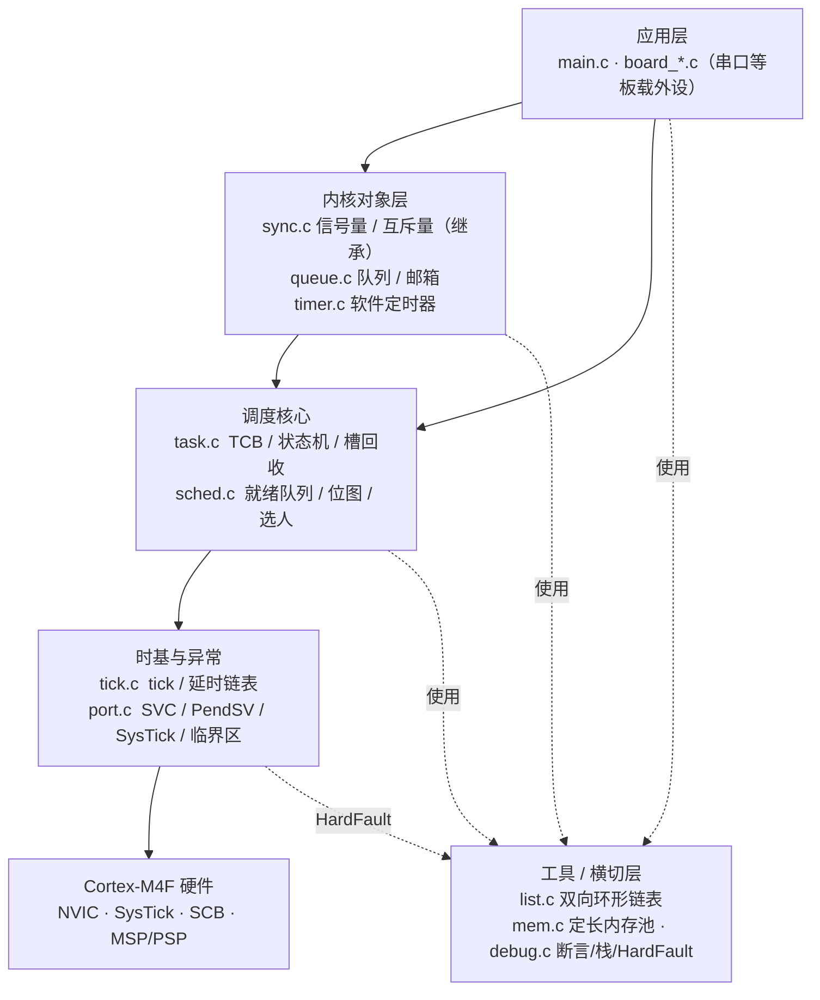
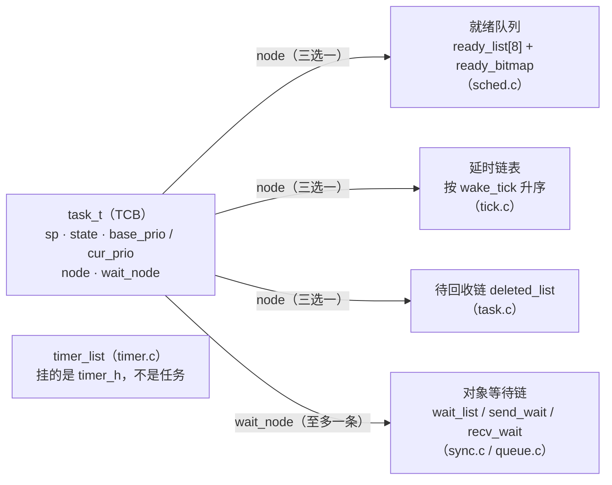
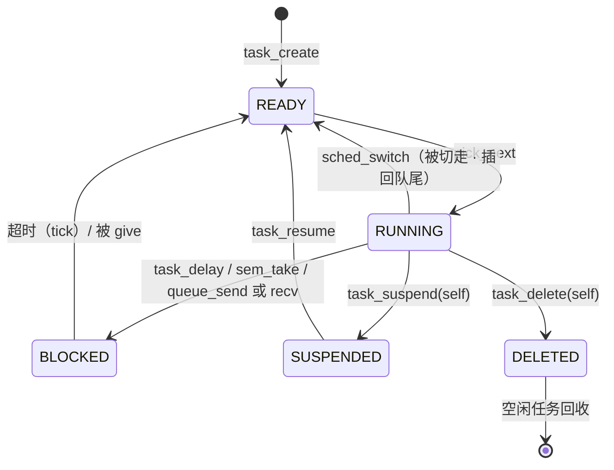
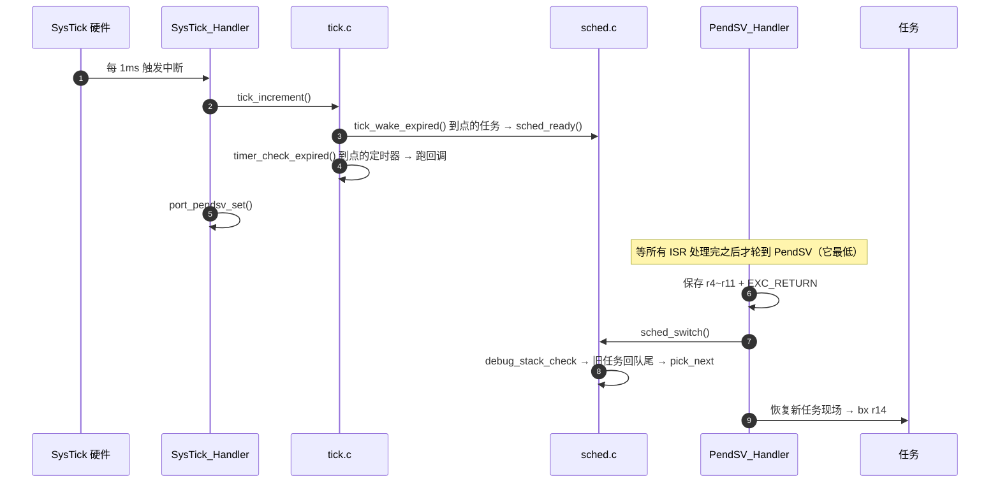
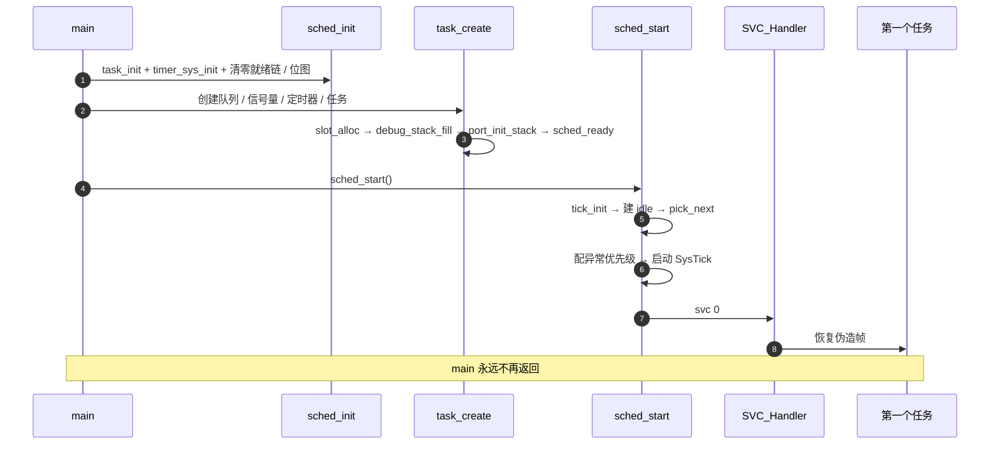

# RTOS 内核架构蓝图（开工前）

> 这份文档是**设计蓝图**，不是实现说明。
> 它规定：系统**应该**长成什么样、为什么这么定、哪些边界不许越、怎么算做完。
> `RTOS/inc` + `RTOS/src` 里的代码是按它长出来的；实现和蓝图不一致时，
> **回到这里改蓝图**，而不是让两边悄悄漂移。
> 图形版（Mermaid）见 **§12** —— Typora 直接渲染。

---

## 0. 一页纸摘要

| 项 | 决定 |
|---|---|
| 定位 | Cortex-M4F 单核、抢占式、**全静态分配**的教学型 RTOS 内核 |
| 规模上限 | 8 个任务槽 / 8 个优先级 / 每任务 128 字栈 / 1 ms tick |
| 调度 | 一条优先级一条就绪链 + 位图 `CLZ` 选最高；同优先级轮转 |
| 切换 | 延迟切换：中断里只置 PendSV，PendSV 负责换现场 |
| 时间 | 绝对时刻 + 有符号差值；延时链表和定时器链都按到期时刻升序 |
| 同步 | 信号量 / 互斥量（优先级继承）/ 队列（拷贝语义）/ 邮箱 |
| 内存 | 静态对象池 + 定长块池；**内核里没有 malloc** |
| 健壮性 | 断言（文件:行号）/ 栈水印 / HardFault 现场解析 |
| 分层 | 应用+外设 / 内核对象 / 调度核心 / 时基+异常 / 硬件，**单向依赖** |

**五条核心不变量**（后面 §4.3 展开，任何设计都不能破坏它们）：

1. 正在跑的任务（RUNNING）**不在任何链上**；
2. `ready_bitmap` 的每一位与对应优先级链表的非空状态**一一对应**；
3. 一个任务的 `node` 同一时刻只可能在**一条**状态链上；
4. 一个任务的 `wait_node` 至多挂在**一条**事件等待链上；
5. 任何会改链表 / 位图 / 对象状态的代码**必须在临界区里**。

---

## 1. 目标与非目标

### 1.1 目标（按优先级排序）

1. **机制可读**：每条关键路径都能在 1~3 个文件里读完；不用条件编译藏分支。
2. **行为可预测**：调度、阻塞、唤醒、定时器检查的最坏路径都是常数时间或可控的。
3. **出问题能定位**：断言给出文件行号；栈溢出能被发现；跑飞能拿到 PC/CFSR。
4. **零动态分配**：所有内核对象和栈在编译期确定，运行期不分配、不碎片。
5. **可裁剪**：不用队列/定时器/内存池时，可以不编译对应模块。

### 1.2 非目标（明确不做）

- 多核 / SMP、MMU/MPU 任务隔离、动态堆分配器、C++ 依赖；
- 多架构可移植抽象（只做 Cortex-M4/M4F，寄存器直写）；
- 性能极致（不追求跑分，只追求**可解释**）；
- POSIX / CMSIS-RTOS 兼容层。

> 把"不做什么"写清楚，和"做什么"一样重要 —— 它防止项目中途被拖进无限范围。

---

## 2. 需求

### 2.1 能力清单（按里程碑）

| 里程碑 | 能力 |
|---|---|
| M1 | 最小调度：栈帧伪造、SVC 首启、PendSV 切换、SysTick 时基 |
| M2 | 就绪队列：链式多任务、位图选最高 |
| M3 | 任务状态机：READY/RUNNING/BLOCKED/SUSPENDED/DELETED |
| M4 | 时间阻塞：`task_delay`、延时链表、超时 |
| M5 | 抢占：优先级 + （同优先级）轮转、唤醒即抢占 |
| M6 | 同步原语：信号量、互斥量（优先级继承） |
| M7 | IPC：消息队列、邮箱 |
| M8 | 软件定时器：周期 / 单次 |
| M9 | 内存管理：定长块池 |
| M10 | 健壮性：断言、栈溢出检测、HardFault 现场 |

### 2.2 非功能需求（设计约束）

| 指标 | 目标 |
|---|---|
| 临界区长度 | ≤ 几十个时钟周期；**临界区里不许循环、不许打印** |
| 任务唤醒延迟 | 从事件发生到任务真正运行 ≤ 1 tick（1 ms） |
| 选人复杂度 | O(1)（位图 + CLZ） |
| 链表操作 | 全部 O(1)（插入/摘除），有序插入为 O(n) |
| 内核 RAM | 目标 ≤ 8 KB（含任务池与栈） |
| 中断延迟 | 由 BASEPRI 阈值决定，高优先级外设可不受内核临界区影响 |

---

## 3. 总体架构

### 3.1 分层与依赖规则

```
┌────────────────────────────────────────────────────────────────────────┐
│  应用层             main.c  +  board_*.c（串口等板载外设）              │
└───────────────┬──────────────────────────────────┬─────────────────────┘
                │                                  │
┌───────────────▼──────────────────┐   ┌───────────▼─────────────────────┐
│  内核对象层                       │   │  工具 / 横切层                   │
│  sync.c    信号量、互斥量(继承)    │   │  list.c   双向环形链表           │
│  queue.c   队列、邮箱              │   │  mem.c    定长内存池             │
│  timer.c   软件定时器              │   │  debug.c  断言/栈/HardFault      │
└───────────────┬──────────────────┘   └─────────────────────────────────┘
                │
┌───────────────▼────────────────────────────────────────────────────────┐
│  调度核心          task.c  +  sched.c                                  │
│  TCB / 任务池 / 槽位图 / 就绪队列+位图 / 选人 / 状态机 / 槽回收         │
└───────────────┬────────────────────────────────────────────────────────┘
                │
┌───────────────▼────────────────────────────────────────────────────────┐
│  时基与异常        tick.c  +  port.c                                   │
│  tick 计数 / 延时链表 / SysTick / PendSV / SVC / HardFault / BASEPRI   │
└───────────────┬────────────────────────────────────────────────────────┘
                │
┌───────────────▼────────────────────────────────────────────────────────┐
│  Cortex-M4F 硬件   NVIC · SysTick · SCB · MSP/PSP · 异常返回            │
└────────────────────────────────────────────────────────────────────────┘
```

**依赖规则（硬性）**

- 只允许**向下**依赖；同一层内允许横向调用（如 sync → task/sched）。
- **对象层不许直接碰就绪队列和位图** —— 只能通过这三个门：
  `sched_ready()` / `task_block_current()` / `sched_set_priority()`。
- **调度层不许知道"信号量/队列/定时器"的存在**（它只认识任务）。
- `port.c` 是**唯一**允许出现内联汇编和寄存器地址的内核文件。
- `board_*.c` 与 `main.c` 属于应用层，**不许进 `inc/` / `src/`**。

### 3.2 模块地图

| 模块 | 职责 | 对外接口 | 依赖 | 关键约束 |
|---|---|---|---|---|
| `list.c` | 双向环形链表 + `container_of` | init/insert/remove/is_empty/count | — | 节点内嵌；`container` 标识归属 |
| `task.c` | TCB、任务池、状态机、阻塞/唤醒、槽回收 | create/delay/block/unblock/suspend/resume/delete | sched, tick, port, debug | 槽复用；回收只能由空闲任务做 |
| `sched.c` | 就绪队列、位图、选人、切人、优先级修改 | ready/pick/switch/yield/dequeue/set_priority/init | task, port, list | 位图与链表必须同步 |
| `tick.c` | tick 计数、延时链表、到点唤醒 | tick_init/get/ms_to_ticks/increment/delay_insert | sched, list, timer | 时间比较必须有符号差值 |
| `port.c` | 栈帧、EXC_RETURN、SVC/PendSV/SysTick/HardFault、临界区 | init_stack/first_start/pendsv_set/systick_*/critical_* | debug | PendSV **必须**最低优先级 |
| `sync.c` | 信号量、互斥量（优先级继承） | sem_init/take/give；mutex_init/lock/unlock | task, sched, port | give 只能"转手"或"计数"二选一 |
| `queue.c` | 环形缓冲队列、邮箱 | queue_init/send/recv/count；mailbox_* | task, sched, tick, port | 拷贝语义；醒来必须重试 |
| `timer.c` | 软件定时器（周期/单次） | timer_sys_init/init/start/stop/restart/check_expired | tick, list, port | 回调跑在 tick 中断里 |
| `mem.c` | 定长块池 | pool_init/alloc/free/reset/… | list, port | free 必须传 alloc 的返回值 |
| `debug.c` | 断言、栈水印、HardFault 现场 | assert_failed/stack_fill/stack_check/hardfault_report | port | `debug_info` 必须 `volatile` |

### 3.3 目录与命名规范

```
project/
├── inc/            内核头文件（只放内核）
├── src/            内核实现（只放内核）
├── demo/ 或根目录   应用：main.c + board_*.c（板载外设）
├── CMSIS/          芯片头文件
└── startup/ld/     启动文件与链接脚本
```

| 规则 | 例子 |
|---|---|
| 类型名 `xxx_t` | `task_t`、`sem_t`、`queue_t`、`timer_h` |
| 函数名 `模块_动作` | `sched_ready`、`timer_start`、`mem_alloc` |
| 板载外设加 `board_` 前缀 | `board_uart_init` |
| 中断入口固定名字 | `SVC_Handler`、`PendSV_Handler`、`SysTick_Handler` |
| 内核对象由调用方提供存储 | `queue_init(&q, buf, size, depth)` |
| 不写条件编译 | 只有 `CFG_ASSERT_ENABLE` 这种"开关"例外，且用 `if` 不用 `#if` |

---

## 4. 核心数据模型

### 4.1 TCB（任务控制块）

```c
typedef struct task {
    uint32_t *sp;              /* 现场锚点；★ 必须是第一个成员（汇编按偏移取） */
    uint32_t *stack_top;       /* 栈顶（高地址端） */
    void (*entry)(void);       /* 任务函数（不返回） */
    void (*exit)(void);        /* 万一 return 的落点 = 自杀钩子 */
    uint32_t base_prio;        /* 基础优先级（永不变） */
    uint32_t cur_prio;         /* 生效优先级（继承会临时抬高） */
    task_state_t state;
    list_node_t node;          /* 状态链：就绪 / 延时 / 待回收（三选一） */
    list_node_t wait_node;     /* 事件链：信号量/锁/队列（至多一条） */
    uint32_t wake_tick;        /* 超时时刻（绝对） */
    task_wait_result_t wait_result;
    const char *name;
    uint32_t stack[CFG_STACK_WORDS];
} task_t;
```

**设计约束**

- `sp` 必须是**第一个成员**：PendSV 用 `ldr r0, [tcb]` 直接取；
- `base_prio` 与 `cur_prio` 分离，是为了优先级继承"抬得上去、还得回来"；
- **两个节点**：一个任务可能"同时"在等锁和等超时，一个节点只能挂一条链。

### 4.2 五条链

| 链 | 定义位置 | 挂谁 | 节点 | 有序？ |
|---|---|---|---|---|
| `ready_list[CFG_PRIO_LEVELS]` + `ready_bitmap` | sched.c | 可运行任务 | `node` | 否（FIFO） |
| `delay_list` | tick.c | 睡到某 tick 的任务 | `node` | **按 wake_tick 升序** |
| `deleted_list` | task.c | 已删除、待回收的任务 | `node` | 否 |
| `wait_list` / `send_wait` / `recv_wait` | sync.c / queue.c | 等某对象的任务 | `wait_node` | 否（FIFO） |
| `timer_list` | timer.c | 定时器（不是任务） | `timer_h.node` | **按 expire 升序** |

**为什么有序链只在"时间"这两条上**：它们每个 tick 都要问"谁到点了"，
升序 + 只看队头能把每次检查降到 O(1)；插入时多花一次扫描，换每秒 1000 次的省。

### 4.3 不变量（任何改动都必须满足）

1. **RUNNING 的任务不在任何链上**；`current_task` 指向它。
2. `ready_bitmap` 与 `ready_list[]` 的非空状态**一一对应**。
3. 一个任务的 `node` 同一时刻只可能在 `ready_list` / `delay_list` / `deleted_list` 之一。
4. 一个任务的 `wait_node` 至多挂在一条事件等待链上。
5. 每个链表操作都要成对维护 `count` 与 `container`；`list_remove` 必须幂等。
6. 改链表 / 位图 / 对象状态，必须在 `port_enter_critical()` 保护的区间里。
7. `port_enter_critical/exit` 必须成对；允许嵌套，由计数器管理。

### 4.4 任务状态机

```
                     sched_ready()
        ┌──────────────────────────────────┐
        │                                  ▼
   ┌────┴────┐   pick_next()   ┌──────────────┐
   │ READY   │────────────────►│   RUNNING    │
   └────▲────┘                 └──────┬───────┘
        │                             │
        │ sched_ready()               ├─ task_delay / 等对象 ──► BLOCKED ──┐
        │                             │        (挂 delay_list / wait_node)  │
        │                             │                                      │
        │                             ├─ task_suspend(self) ──► SUSPENDED   │
        │                             │                                      │
        │                             └─ task_delete(self) ───► DELETED     │
        │                                                                    │
        └──────────── 超时 / 被 give / resume / 回收完成 ◄──────────────────┘
                                （DELETED 不会再回 READY）
```

| 迁移 | 触发者 | 副作用 |
|---|---|---|
| RUNNING → READY | `sched_switch`（被切走） | 插回本优先级队尾 |
| READY → RUNNING | `pick_next` | 从队头摘下，`current_task` 指向它 |
| RUNNING → BLOCKED | `task_delay` / `sem_take` / `queue_*` | 挂延时链和/或等待链，然后让出 |
| BLOCKED → READY | 超时（tick）/ 被 give（对象） | 从所有链上摘干净，`wait_result` 区分原因 |
| RUNNING → SUSPENDED | `task_suspend(self)` | 摘链，让出 |
| SUSPENDED → READY | 别人 `task_resume` | 插就绪队尾 |
| RUNNING → DELETED | `task_delete(self)` | 挂 `deleted_list`，让出 |
| DELETED → 槽空闲 | 空闲任务 `task_reclaim_deleted` | 清位图、清 `name` |

---

## 5. 关键设计决策（含备选与代价）

| # | 决策 | 备选 | 为什么选它 | 代价 |
|---|---|---|---|---|
| 1 | 每优先级一条就绪链 + 位图 `CLZ` | 单条排序链 O(n)；堆 | 选人 O(1)，代码量小 | 优先级层数受位图宽度限制（≤32） |
| 2 | PendSV 最低优先级 + 延迟切换 | 在 SysTick ISR 里直接切 | 不打断其他 ISR；多个 tick 合并为一次切换 | **PendSV 必须最低**，否则异常返回不合法（见风险） |
| 3 | 软件帧 9 字（含 EXC_RETURN） | 8 字，EXC_RETURN 压 MSP | 首次启动复用同一条恢复路径 | 每任务多 4 字节 |
| 4 | BASEPRI 临界区（阈值 0x10） | PRIMASK 关全部中断 | 保留高优先级外设的实时性 | ISR 想用内核 API 时优先级必须 ≥0x10 |
| 5 | 静态任务池 + 槽位图 | 链表式动态分配 | 永不失败、不碎片、可预测 | 任务数上限固定；删除后要等空闲任务回收 |
| 6 | 删除任务"先记账、后回收" | 当场回收 | 删除自己时还在用自己的栈 | 回收被推迟到空闲任务运行 |
| 7 | 队列拷贝语义 | 传指针 | 边界干净、无所有权问题 | 每次收发多一次 memcpy；必须知道 item_size |
| 8 | 两个链表节点 | 一个节点 + 状态判断 | "等对象 + 等超时"会同时发生 | TCB 多 12 字节 |
| 9 | 绝对时刻 + 有符号差值 | 相对剩余时间；无符号比较 | 不漂移；回绕安全 | 每次比较要转有符号 |
| 10 | `TASK_WAIT_FOREVER` 专门常量 | 一个很大的数 | 大数加法会回绕成"已过期" | 调用链上要专门判断 |
| 11 | 定时器/延时链有序插入 | 每次 tick 全扫 | 每 tick O(1) | 插入 O(n) |
| 12 | 定长内存池 | malloc / 可变块堆 | O(1)、不碎片、可中断安全 | 块大小固定、有浪费；重复 free 不检测 |
| 13 | 断言 + 返回值 + HardFault 三层错误策略 | 统一用断言 / 统一返回码 | 各司其职：配置错误 / 运行期错误 / 灾难 | 使用者要分清边界 |
| 14 | 设备代码放 `demo/`（`board_*`） | 混在 `inc/src` | 换板子不动内核 | 应用层要多一层目录 |

---

## 6. 接口契约

### 6.1 调用上下文规则（谁能在哪里调）

| API 类别 | 任务上下文 | ISR 里 | 说明 |
|---|---|---|---|
| 会阻塞的：`task_delay`、`sem_take`、`mutex_lock`、`queue_send/recv`（带超时） | ✅ | ❌ | ISR 里阻塞 = 死锁 |
| 不阻塞的：`sem_give`、`mutex_unlock`、`queue_send(timeout=0)`、`task_unblock` | ✅ | ✅* | *ISR 优先级必须 ≥ `CFG_BASEPRI_MASK` |
| 调度：`sched_yield` | ✅ | ❌ | ISR 里用 `port_pendsv_set()` |
| 对象/任务管理：`task_create`、`timer_start`、`queue_init`、`mem_*` | ✅ | ❌（除 `mem_alloc/free` 在临界区内是短的） | 启动期或任务里 |
| 临界区：`port_enter/exit_critical` | ✅ | ✅ | 嵌套计数 |

### 6.2 返回码与等待时长约定

```c
SYNC_OK      =  0        /* 成功 */
SYNC_TIMEOUT = -1        /* 超时 / 没等到 */

timeout_ticks == 0            → 不等，试一次就走（由对象层处理，不传给 block）
0 < timeout < TASK_WAIT_FOREVER → 最多等这么多 tick
timeout_ticks == TASK_WAIT_FOREVER (0xFFFFFFFF) → 一直等，只能被别人叫醒
```

### 6.3 所有权与生命周期

- **内核对象由调用方提供存储**：队列缓冲、内存块、定时器、任务栈全部静态声明；
- 任务句柄在"删除并回收"之后失效；回收由空闲任务完成；
- 队列是**拷贝语义**：发送方拷完即可释放原数据；
- 定时器回调在 **tick 中断上下文**运行：短、不能阻塞、不能打印。

### 6.4 公开 API 一览

| 模块 | API |
|---|---|
| 调度 | `sched_init` `sched_start` `sched_ready` `sched_yield` `sched_need_switch` |
| 任务 | `task_init` `task_create` `task_self` `task_delay` `task_block_current` `task_unblock` `task_suspend` `task_resume` `task_delete` `task_reclaim_deleted` |
| 时基 | `tick_init` `tick_get` `tick_increment` `tick_ms_to_ticks` `tick_delay_insert` |
| 信号量 | `sem_init` `sem_take` `sem_give` |
| 互斥量 | `mutex_init` `mutex_lock` `mutex_unlock` |
| 队列/邮箱 | `queue_init` `queue_send` `queue_recv` `queue_count` `mailbox_init` `mailbox_put` `mailbox_get` |
| 定时器 | `timer_sys_init` `timer_init` `timer_start` `timer_stop` `timer_restart` `timer_check_expired` |
| 内存池 | `mem_pool_init` `mem_alloc` `mem_free` `mem_pool_reset` `mem_free_count` |
| 调试 | `debug_assert_failed` `debug_stack_fill` `debug_stack_check` `debug_hardfault_report` |

---

## 7. 运行时模型

### 7.1 中断优先级规划

| 异常/中断 | 优先级（数值） | 说明 |
|---|---|---|
| SVC | 0 | 首次启动（最高，保证能进） |
| 想**调用内核 API** 的外设中断 | 0x10 ~ 0xE0 | **必须 ≥ `CFG_BASEPRI_MASK`**，才能被临界区挡住 |
| 不碰内核的高实时外设 | 0x00 ~ 0x0F | 可以打断临界区，但**不许**碰内核对象 |
| SysTick / PendSV | 0xF0（最低） | PendSV 必须最低（见 §11） |

**规则一句话**：临界区用 `BASEPRI = 0x10`，挡住"数值 ≥ 0x10"的中断；
所以**凡是想在内核里安全调用的 ISR，优先级数值必须 ≥ 0x10**。

### 7.2 tick 与切换

```
SysTick_Handler
 ├─ tick_increment()
 │   ├─ tick_wake_expired()    延时链表队头 → sched_ready
 │   └─ timer_check_expired()  定时器链队头 → 回调（ISR 上下文）
 └─ port_pendsv_set()
       ↓（所有 ISR 结束）
PendSV_Handler
 ├─ 保存 r4~r11 + EXC_RETURN
 ├─ sched_switch(): debug_stack_check → 旧任务回队尾 → pick_next
 └─ 恢复新任务现场 → bx r14
```

**调度时机（设计目标）**：tick 是兜底；**当出现"更高优先级就绪"或"同优先级有别人"时，
应当主动置 PendSV**（这就是 `sched_need_switch()` 的职责，调用点：任务创建、唤醒、解锁降优先级之后）。

### 7.3 启动顺序（必须遵守）

```
sched_init()          task_init + timer_sys_init + 就绪链/位图清零
  ↓
创建对象 / 任务        queue_init / sem_init / timer_init+start / task_create
  ↓                   （此时内核对象已可用，但调度器还没跑）
sched_start()         tick_init → 建 idle → pick_next → 配异常优先级
                      → 启动 SysTick → svc 0
  ↓
SVC_Handler           恢复第一个任务的伪造帧 → 永远不再回 main
```

**顺序约束**：任何"启动后才会用到的初始化"都必须早于第一次 `timer_start` / `task_create`。

---

## 8. 资源预算

| 项 | 预算 | 说明 |
|---|---|---|
| 任务池 | `CFG_MAX_TASKS × sizeof(task_t)` ≈ 8 × 600 B ≈ 4.8 KB | 含 128 字栈 |
| 就绪队列 / 位图 | 8 × 16 B + 4 B | 很小 |
| 内核 .bss 总计 | ≤ 8 KB | 目标值 |
| 固件（text） | ≤ 16 KB | 教学版目标，不追求极致 |
| 临界区 | ≤ 几十个周期 | 禁止循环/打印 |
| 每 tick 工作量 | 延时链队头 + 定时器队头 | O(1) |

---

## 9. 阶段划分与验收标准（可观察）

| 阶段 | 完成标志（能在板子上看到/在调试器里验证） |
|---|---|
| M1 | 两个任务交替翻转 GPIO；PendSV 里能看到两个 `sp` 轮换 |
| M2 | N 个任务按优先级运行；同优先级两个任务交替 |
| M3/M4 | 任务 `delay` 后不再占 CPU；空闲任务在 WFI；延时链队头按 wake_tick 升序 |
| M5 | 高优先级任务就绪后立刻抢占（或最迟下一个 tick）；同优先级轮转 |
| M6 | 信号量"转手"；互斥量能挡住优先级反转（实验：注释继承代码，时间差变大） |
| M7 | 队列满时发送方睡眠；收方取走后发送方被唤醒；邮箱读到跳变的状态 |
| M8 | 周期定时器计数稳定增长（不漂移）；单次定时器只触发一次 |
| M9 | 池子借还 O(1)；`mem_free_count` 回到初值；重复 free 不被误用 |
| M10 | 栈灌 `0xA5`；切开 `CFG_STACK_CHECK` 能看到断言；人为写野地址能停在 `debug_hardfault_report` 并读到 PC/CFSR |

---

## 10. 编码与文档规范

- 注释写**为什么**，不写"这行是什么"；涉及寄存器和栈布局的地方标注依据（手册/TRM）。
- 每个模块头注释包含四段：**职责 / 对外接口 / 不变量 / 调用上下文**。
- 不写条件编译；开关用 `if (CFG_XXX)` 让代码保持可见。
- 常量集中在 `kernel_cfg.h`；不在源码里散落魔数。
- 每个阶段：一个可编译运行的 commit + 一份阶段笔记（设计 + 踩坑）。
- **蓝图是源**: 实现与蓝图不一致时，先改蓝图，再改代码（或反之），禁止两边各说各话。

---

## 11. 设计约束与已知风险（设计决定，不是待办）

| 风险/约束 | 说明 | 设计上的应对 |
|---|---|---|
| **PendSV 必须最低优先级** | 只有最外层异常才有资格"返回线程模式"；PendSV 嵌进别的异常后 `bx lr` 会被硬件判掉 | 在 `port_set_exception_priorities()` 里固定 0xF0；任何改优先级的地方都要保住这条 |
| **FPU 现场未保存** | 编译是 hard-float 且 SystemInit 已开 FPU；PendSV 只存 r4~r11 | 设计约束：**任务里不许用 float/double**，直到实现 s16~s31 保存 |
| 调度粒度 1 tick | 唤醒/创建后的切换可能晚 ≤1 ms | 允许；用 `sched_need_switch()` 在关键路径上主动置 PendSV |
| 优先级继承是简化版 | 不做传递继承；多把锁时直接回 `base_prio` | 文档化；真实项目需要按"最高抬高因素"计算 |
| 删除任务不唤醒等待者 | 等它的任务可能永远等下去 | 当前不处理；真系统需在删除时唤醒并返回失败 |
| 内存池无重复 free 检测 | 约定 + 边界断言 | 使用者契约：一对一的 alloc/free |
| 中断里调用内核 API 的边界 | 只有优先级 ≥0x10 的 ISR 才安全 | 写进 §7.1；新增外设中断时先对照这张表 |
| 硬件浮点 + nano printf | `%f` 默认不可用 | 打印用整数；需要浮点格式化时显式加链接选项 |

---

## 12. 图形版（Mermaid）

> Typora 直接渲染下面的图（GitHub 也支持）。正文对应小节里有 ASCII 版，两版内容一致。
> **图里的箭头一律表示"依赖 / 调用方向"，只能向下**；反向只有 `port.c → debug.c`
> 这一处（HardFault 报告），它是叶子工具。

### 12.1 分层架构与依赖方向



### 12.2 数据模型：一个 TCB + 五条链



> 两条不变量：**RUNNING 不在任何链上**；`node` 三选一、`wait_node` 至多一条。

### 12.3 任务状态机



### 12.4 一个 tick 的时序



### 12.5 启动流程


